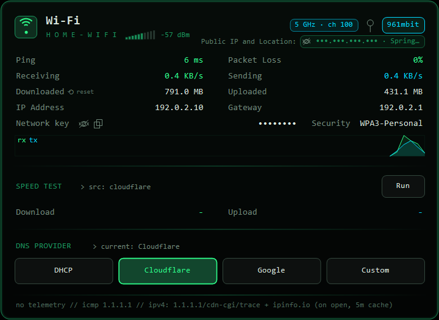

<div align="center">

# ▚ NetPanel

**A glowing, terminal-styled network panel for the Windows tray.**
Inspired by the Omarchy network panel — dark, emerald, Consolas, one click away.



<sub>Screenshot uses dummy values (documentation IP ranges, fake SSID/MAC); key and public IP are masked.</sub>

</div>

---

## ✦ Features

- **Live tray icon** that pulses with network activity; left-click opens the panel near the clock, `Esc` or clicking away closes it.
- **Live stats** every second: receive/send rate, totals (with a one-click **reset**), local IP, gateway, sparkline graph.
- **Ping & packet loss** — ICMP to `1.1.1.1` every 2 s, loss over the last 20 pings.
- **Wi-Fi mode** — SSID, real **RSSI in dBm** with a colored signal meter, band/channel chip (e.g. `5 GHz · ch 100`), security type.
- **Network key** row — masked by default; revealed or copied only when you click, never written to disk, re-masked when the panel closes.
- **Ethernet mode** — adapter name, MAC, link speed chip (`wired · 1 Gbit` / `no link`); no Wi-Fi API calls.
- **Offline mode** — clear "no default route" state; refreshes automatically when the network changes.
- **Public IPv4 & location** chip — click to copy, eye icon to mask, cached for 5 minutes.
- **Speed test** — multi-stream download/upload against Cloudflare (Hetzner fallback for download).
- **One-click DNS** — DHCP, Cloudflare, Google or Custom, applied through an elevated helper (UAC prompt) with a backup of the previous servers.
- **Pin & drag** the panel anywhere; **Start with Windows** toggle in the tray menu.
- Single ~60 KB exe, no installer, no runtime to download, no admin required (except when changing DNS).

## ⇩ Install

1. Download **`NetPanel.exe`** from the [latest release](https://github.com/buchanonp/NetPanel/releases/latest).
2. Run it. The icon appears in the tray (check the `^` overflow area).
3. Right-click the icon → **Start with Windows** to launch at login.

> **SmartScreen:** the exe is not code-signed, so Windows may show *"Windows protected your PC"*.
> Click **More info → Run anyway**. You can also build it yourself from source (below) in a few seconds.

Prefer a scripted install? Download `NetPanel-v1.0.0.zip`, extract, and run:

```powershell
powershell -ExecutionPolicy Bypass -File .\install.ps1
```

This copies the exe to `%LOCALAPPDATA%\Programs\NetPanel`, adds a per-user startup entry and launches it.

## ⚙ Requirements

- Windows 10 or 11
- .NET Framework 4.x (built into Windows 10/11 — nothing to install)

## 🔒 Privacy

No telemetry, no accounts, no analytics. The only network traffic NetPanel generates:

| When | Endpoint | Why |
|---|---|---|
| Every 2 s while running | ICMP ping to `1.1.1.1` | latency / packet loss |
| When the panel opens (cached 5 min) | `https://1.1.1.1/cdn-cgi/trace` | your public IPv4 |
| Same time, after the above | `https://ipinfo.io/<ip>/json` (fallback `speed.cloudflare.com/meta`) | city/region for the chip |
| Only when you click **Run** | `speed.cloudflare.com` (fallback `ash-speed.hetzner.com`) | speed test |

The Wi-Fi key is read locally via `netsh` only when you click reveal/copy and is kept in memory only.
Local files live in `%LOCALAPPDATA%\NetPanel`: `settings` (pin/position/counter baseline) and `dns-backup.txt` (written only when you change DNS).

## 🛠 Build from source

No Visual Studio or .NET SDK needed — Windows already ships the C# compiler.

```cmd
git clone https://github.com/buchanonp/NetPanel.git
cd NetPanel
build.cmd
```

`build.cmd` uses `%WINDIR%\Microsoft.NET\Framework64\v4.0.30319\csc.exe` and produces `NetPanel.exe`.

### Developer flags

| Flag | Effect |
|---|---|
| `--log` (or `NETPANEL_LOG=1`) | write speed-test diagnostics to `%LOCALAPPDATA%\NetPanel\speedtest.log` |
| `--dev` (or `NETPANEL_DEV=1`) | enable the test hook: `NetPanel.exe --trigger` runs a speed test and saves a screenshot to `%LOCALAPPDATA%\NetPanel`; if a `cmd.txt` exists there it runs that command instead (`demo` = render with dummy values, `force=ethernet` = preview Ethernet mode once) |

The hook is inactive in normal runs.

## ✕ Uninstall

1. Right-click the tray icon → uncheck **Start with Windows** → **Exit**.
2. Delete `NetPanel.exe` and the `%LOCALAPPDATA%\NetPanel` folder.

Or, if you used the script: `powershell -ExecutionPolicy Bypass -File .\uninstall.ps1`

DNS changes are not reverted automatically — click **DHCP** before uninstalling if you changed DNS.

## License

[MIT](LICENSE) © buchanonp
