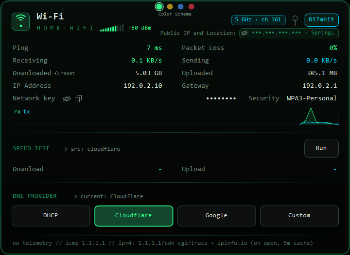
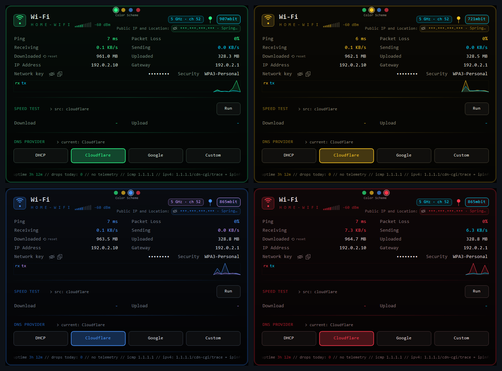

<div align="center">

# ▚ NetPanel

**A glowing, terminal-styled network panel for the Windows tray.**
Inspired by the Omarchy network panel — dark, emerald, Consolas, one click away.



<sub>Screenshot uses dummy values (documentation IP ranges, fake SSID/MAC); key and public IP are masked.</sub>

</div>

---

## ✦ Features

- **Live tray icon** with download/upload activity bars and a rate tooltip; left-click opens the panel near the clock, `Esc` or clicking away closes it (unless pinned).
- **Live stats** every second: receive/send rate, totals (with a one-click **⟲ reset**), local IP, gateway, sparkline graph.
- **Ping & packet loss** — ICMP to `1.1.1.1` every 2 s while the panel is open, loss over the last 20 pings.
- **Wi-Fi mode** — SSID, real **RSSI in dBm** with a colored signal meter, band/channel chip (e.g. `5 GHz · ch 100`), security type.
- **Network key** row — masked by default; revealed or copied only when you click, never written to disk, re-masked when the panel closes.
- **Ethernet mode** — adapter name, MAC, link speed chip (`wired · 1 Gbit` / `no link`); no Wi-Fi API calls.
- **Offline mode** — clear "no default route" state; refreshes automatically when the network changes.
- **Public IPv4 & location** chip — click to copy, eye icon to mask, cached for 5 minutes.
- **Speed test** — multi-stream download/upload against Cloudflare (Hetzner fallback for download).
- **One-click DNS** — DHCP, Cloudflare, Google or Custom, applied through an elevated helper (UAC prompt) with a backup of the previous servers.
- **Color schemes** — four bubbles at the top of the panel switch the accent instantly between **green** (default), **yellow**, **blue** and **red**; the choice is remembered. See [Color schemes](#-color-schemes).
- **Status footer** — connection uptime (read from Windows, so it is right even after a restart), drops today, and the privacy summary, with a smooth marquee when it doesn't fit. See [Footer](#-footer).
- **Pin & drag** the panel anywhere; **Start with Windows** toggle in the tray menu.
- Single ~75 KB exe, no installer, no runtime to download, no admin required (except when changing DNS).

## ◐ Color schemes

Click one of the four bubbles under the top edge of the panel (labelled *Color Scheme*) to recolor it. The selected bubble shows a ring.

| Theme | Accent | Upload / tx color |
|---|---|---|
| Green (default) | emerald, the original look | cyan |
| Yellow | amber/gold | cyan |
| Blue | azure | violet (cyan would clash with blue) |
| Red | crimson | cyan |

The theme recolors the text highlights, active button, borders, signal meter, graph, icons, the tray icon and the tray menu. The choice is saved as `theme=` in `%LOCALAPPDATA%\NetPanel\settings` and restored on the next start. In the red theme, packet loss is shown in amber so that it still stands out.



<sub>Screenshots use dummy values.</sub>

## ▭ Footer

The bottom line of the panel reads, for example:

`uptime 3h 12m // drops today: 0 // no telemetry // icmp 1.1.1.1 // ipv4: 1.1.1.1/cdn-cgi/trace + ipinfo.io (on open, 5m cache)`

- **Uptime** is how long the current connection has been continuously up. NetPanel reads the connect time from the Windows event log `Microsoft-Windows-NetworkProfile/Operational`: the newest *connected* event (10000) for the active adapter's network, if no newer *disconnected* event (10001) follows it. That log is readable without admin rights. It is read at startup, after a reconnect and on resume, never on a timer, so uptime is accurate right after NetPanel restarts. If nothing is found, uptime counts from when NetPanel started or last saw the link come up.
- **A drop NetPanel sees resets uptime**, even when Windows logged no disconnect (for example, pings failing while the adapter stays up).
- **Sleep / hibernate:** on resume, uptime restarts from the wake-up time; if Windows reconnects the network after waking (normal for Wi-Fi), it follows that connect event.
- **Drops today** counts up→down transitions since local midnight. *Down* means no active connection (adapter down, no default route or offline; checked every 2 s by the tray, every 1 s while the panel is open) or 3 consecutive failed pings (~6 s) while the panel is open. The count is saved in `settings` (`drops=`) and resets at midnight. No extra network traffic: it reuses the existing pings, which only run while the panel is open.
- **Action messages** (for example "public ip copied to clipboard", DNS or speed-test status) replace the line for about 4 s, then fade back.
- **Marquee:** when the line is wider than the panel it scrolls smoothly (~35 px/s) in a seamless loop with soft fades at both edges. Text that fits does not scroll, and animation runs only while the panel is visible.

## ⇩ Install

1. Download **`NetPanel.exe`** from the [latest release](https://github.com/buchanonp/NetPanel/releases/latest).
2. Run it. The icon appears in the tray (check the `^` overflow area).
3. Right-click the icon → **Start with Windows** to launch at login.

> **SmartScreen:** the exe is not code-signed, so Windows may show *"Windows protected your PC"*.
> Click **More info → Run anyway**. You can also build it yourself from source (below) in a few seconds.

Prefer a scripted install? Download `NetPanel-v1.2.0.zip`, extract, and run:

```powershell
powershell -ExecutionPolicy Bypass -File .\install.ps1
```

This copies the exe to `%LOCALAPPDATA%\Programs\NetPanel`, unblocks it, adds a per-user startup entry and launches it.

### Verify the download

Each release includes `SHA256SUMS` (also as `SHA256SUMS.txt`), listing hashes of `NetPanel.exe` and the zip. A copy for the latest release (v1.2.0) is in this repo as [`SHA256SUMS`](SHA256SUMS). Compare with:

```powershell
Get-FileHash .\NetPanel.exe -Algorithm SHA256
```

## ⚙ Requirements

- Windows 10 or 11
- .NET Framework 4.x (built into Windows 10/11 — nothing to install)

## 🔒 Privacy

No telemetry, no accounts, no analytics. The only network traffic NetPanel generates:

| When | Endpoint | Why |
|---|---|---|
| Every 2 s while the panel is open | ICMP ping to `1.1.1.1` | latency / packet loss |
| When the panel opens (cached 5 min) | `https://1.1.1.1/cdn-cgi/trace` | your public IPv4 |
| Same time, after the above | `https://ipinfo.io/<ip>/json` (fallback `speed.cloudflare.com/meta`) | city/region for the chip |
| Only when you click **Run** | `speed.cloudflare.com` (fallback `ash-speed.hetzner.com`) | speed test |

The Wi-Fi key is read locally via `netsh` only when you click reveal/copy and is kept in memory only.
Local files live in `%LOCALAPPDATA%\NetPanel`: `settings` (pin/position/counter baseline/color scheme/today's drop count) and `dns-backup.txt` (written only when you change DNS); `speedtest.log` only if you run with `--log`.

## 🛠 Build from source

No Visual Studio or .NET SDK needed — Windows already ships the C# compiler.

```cmd
git clone https://github.com/buchanonp/NetPanel.git
cd NetPanel
build.cmd
```

`build.cmd` uses `%WINDIR%\Microsoft.NET\Framework64\v4.0.30319\csc.exe` and produces `NetPanel.exe`.

### Developer flags

| Flag | Effect |
|---|---|
| `--log` (or `NETPANEL_LOG=1`) | write speed-test diagnostics to `%LOCALAPPDATA%\NetPanel\speedtest.log` |
| `--dev` (or `NETPANEL_DEV=1`) | enable the test hook: while a `--dev` instance is running, `NetPanel.exe --trigger` makes it run a speed test and saves a screenshot to `%LOCALAPPDATA%\NetPanel`; if a `cmd.txt` exists there it runs that command instead (`demo` = render with dummy values, `force=ethernet` = preview Ethernet mode once) |
| `--shot <file.png> [--speed]` | render the panel to a PNG (plus a `.txt` summary) without the tray, optionally after a speed test |
| `--shot … --theme <green\|yellow\|blue\|red>` | render with that color scheme (not saved to settings) |
| `--shot … --demo` | render with dummy values (documentation IPs, fake SSID/location), useful for screenshots |
| `--shot … --hold <seconds>` | keep the panel running (animations included) for that many seconds before capturing, e.g. to check the footer marquee |

The hook is inactive in normal runs.

## ✕ Uninstall

1. Right-click the tray icon → uncheck **Start with Windows** → **Exit**.
2. Delete `NetPanel.exe` and the `%LOCALAPPDATA%\NetPanel` folder.

Or, if you used the script: `powershell -ExecutionPolicy Bypass -File .\uninstall.ps1` (also deletes `%LOCALAPPDATA%\NetPanel`; add `-KeepSettings` to keep it)

DNS changes are not reverted automatically — click **DHCP** before uninstalling if you changed DNS.

## License

[MIT](LICENSE) © buchanonp
